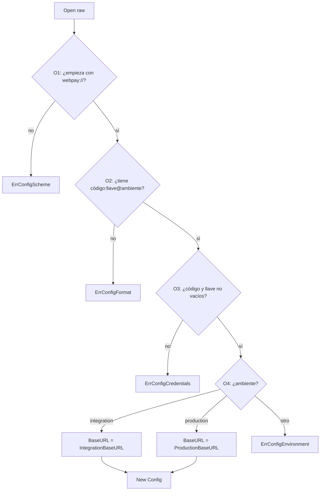
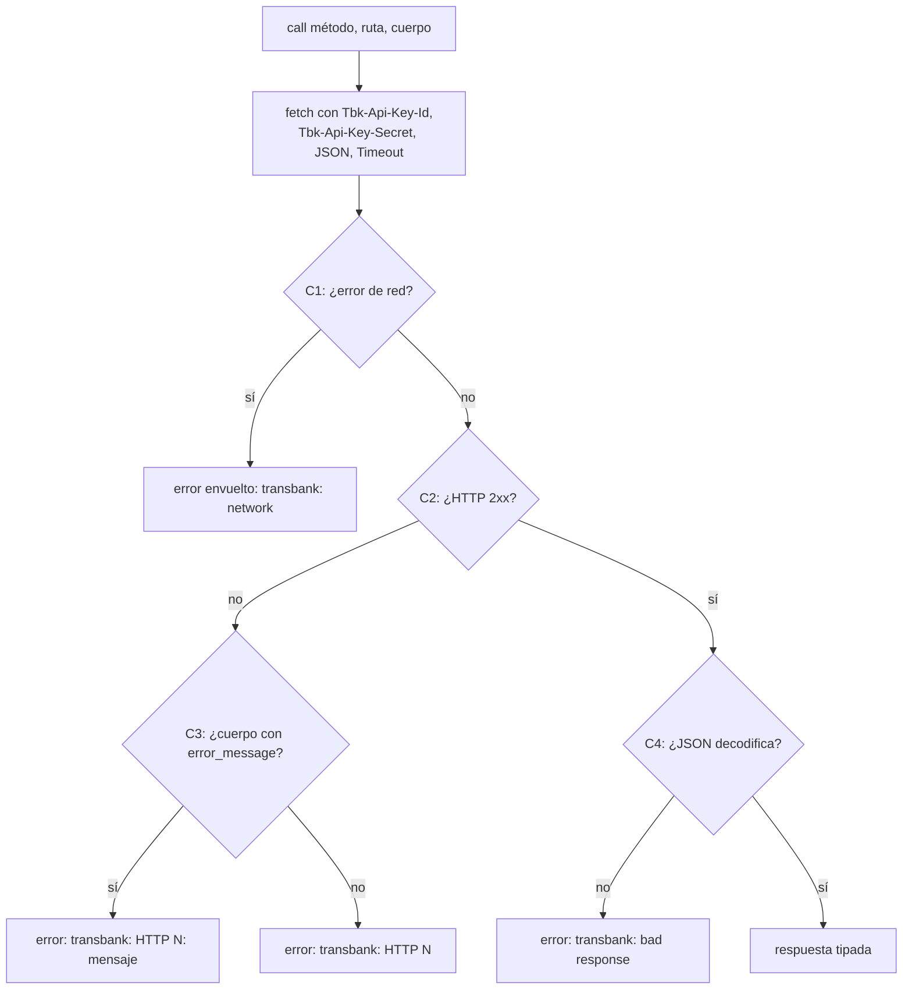
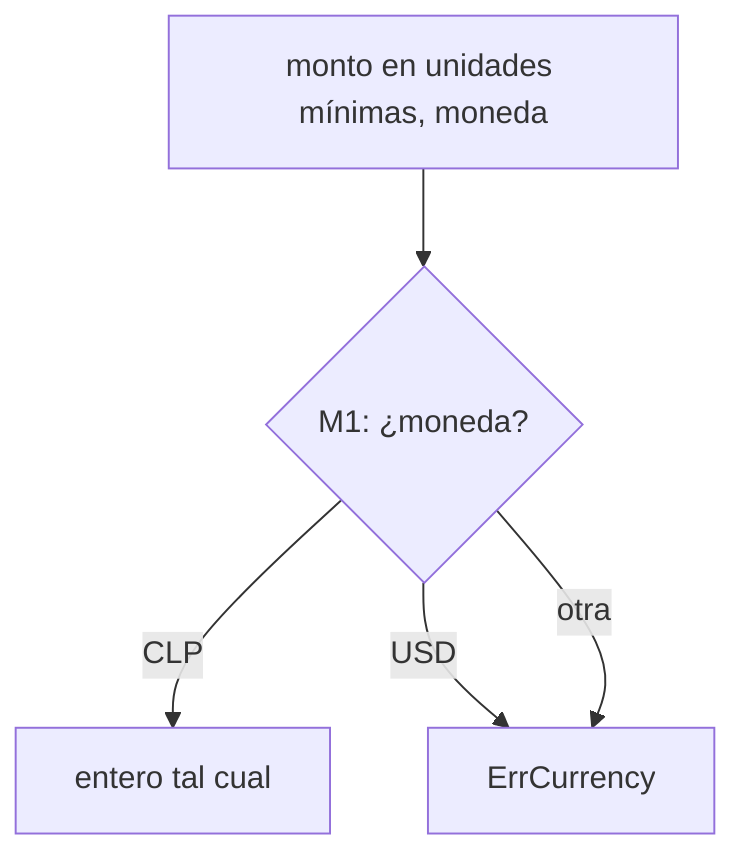
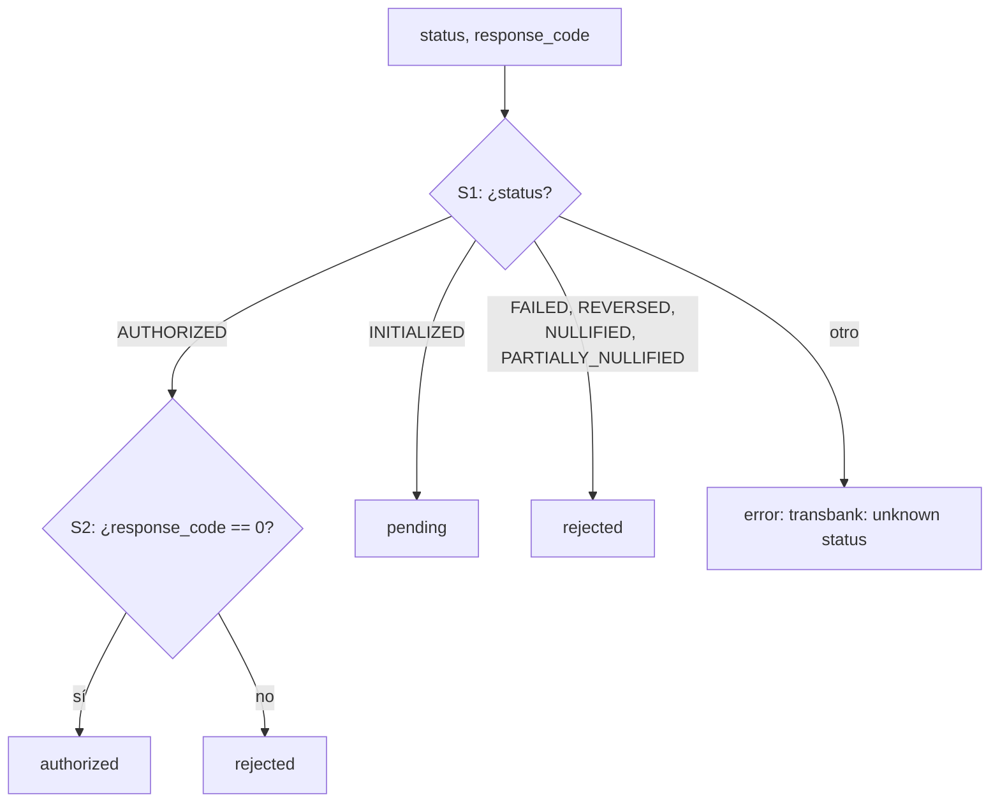
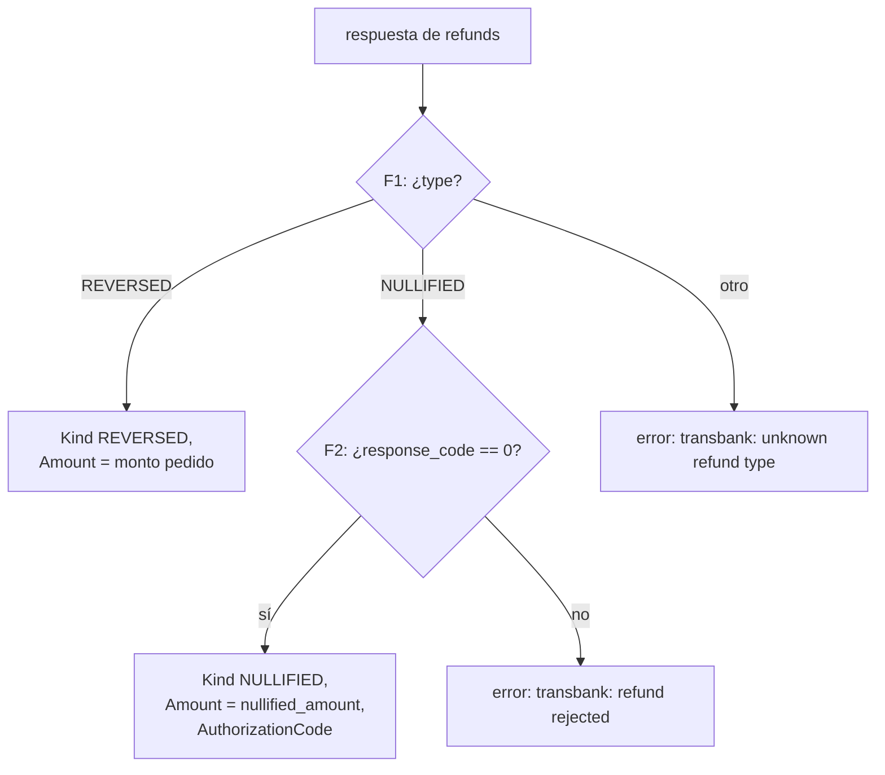
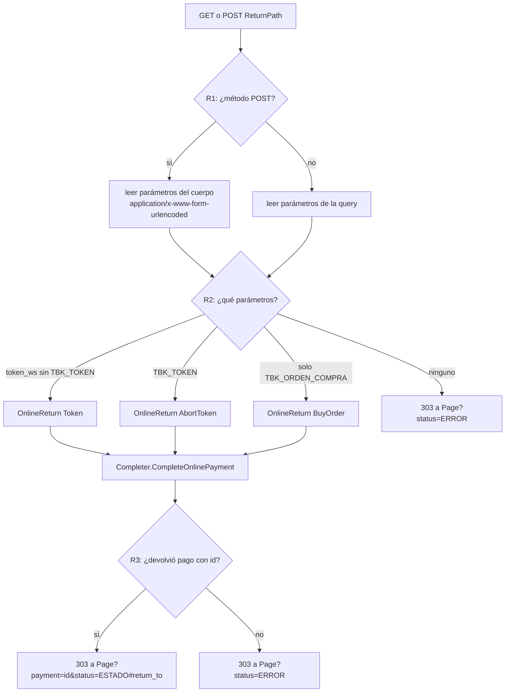

# Flujos de `transbank`

Cada rombo lleva un id. La tabla de trazabilidad de [`docs/PLAN.md`](../PLAN.md) §9 asigna a
cada rama (`O1-sí`, `O1-no`, …) su prueba. Una rama sin prueba es un defecto.

## 1. Configuración (`Open`)

Formato de `TRANSBANK_WEBPAY`: `webpay://<código de comercio>:<llave secreta>@<ambiente>`,
con ambiente `integration` o `production`.

## 2. Llamada a la API (común a Start, Commit, Status, Refund)

## 3. Traducir moneda y monto

Solo CLP. `Commit`, `Status` y `Refund` del `Gateway` no reciben la moneda, así que un monto
USD que sale como decimal no se podría devolver a unidades mínimas; además Webpay cobra USD con
un código de comercio aparte. Cobrar en USD requiere primero extender el puerto en
`payment_manager`.

## 4. Traducir el resultado de Commit/Status (`GatewayResult.Outcome`)

## 5. Traducir la devolución

## 6. Ruta de retorno (`MountReturn`)

Webpay vuelve con GET (producción) o POST de formulario (abandono en integración).

Un error con pago (p. ej. `ErrAmountMismatch` junto al pago `FAILED`) cuenta como `R3-sí`: se
informa el estado del pago.
